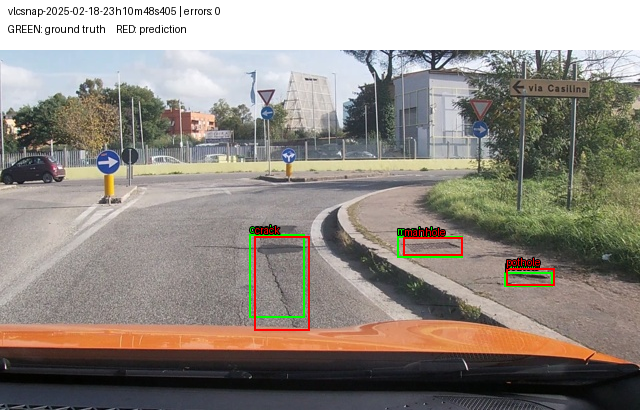
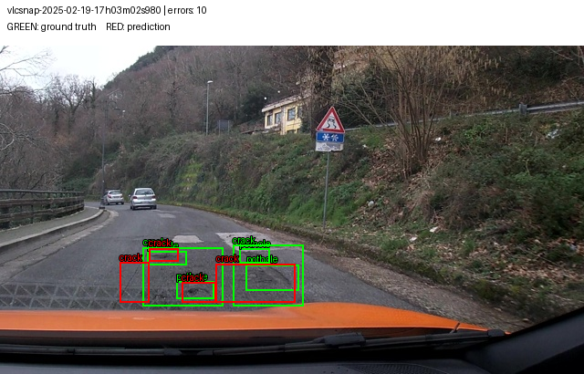
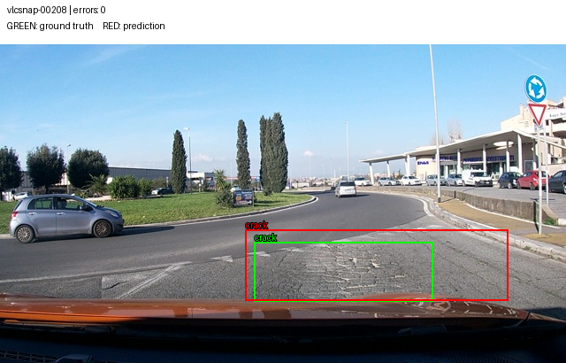
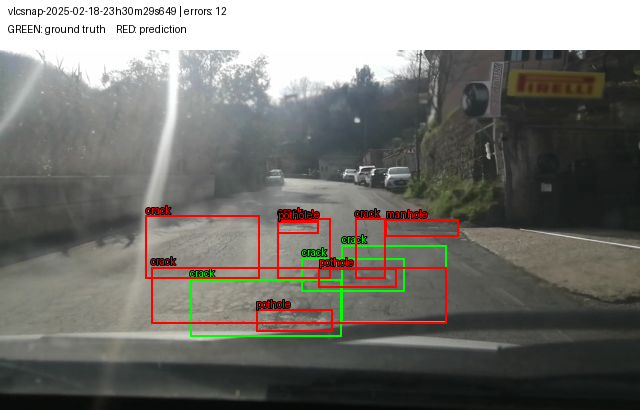
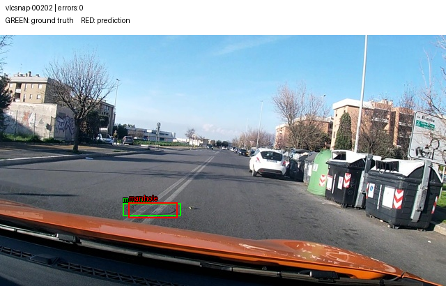
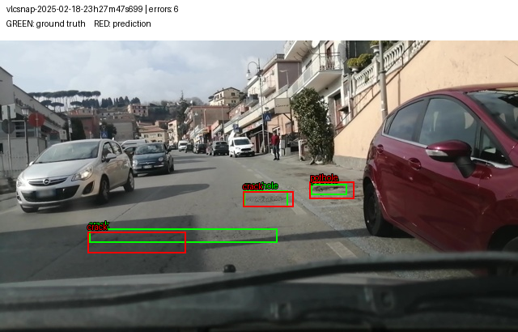

Họ tên: Nguyễn Văn Thân
GitHub: meth04; Kaggle: soobinms
`dataset_version`: d10-21e4070301

## Môi trường và cách tái lập

Chạy trên Kaggle, GPU Tesla T4 (14.56 GiB), chỉ một GPU được nhìn thấy qua CUDA_VISIBLE_DEVICES=0. Đề gốc dùng Colab T4; đây là thay đổi nền tảng và được ghi rõ. Không chạy model trên máy cá nhân. Phiên bản thư viện thực tế nằm trong `report/evidence/preflight.json`. Mã của bài ở `solution/`; `scripts/` và `tests/` giữ nguyên. SFT dùng batch=2, tích lũy=4, 300 bước, LR=2e-4, seed=42. Để tiết kiệm VRAM và thời gian, LM head chỉ tính logits ở vị trí có next-token label khác -100; cross entropy và mask giữ nguyên, được đối chiếu với loss đầy đủ trong thử GPU. Checkpoint chọn theo 40 ảnh validation cố định; báo cáo thêm kết quả trên toàn bộ validation. Mỗi setup suy luận test một lần. Thời gian huấn luyện đo riêng các bước tối ưu, không gồm validation; tổng thời gian chạy sẽ lớn hơn.

Suy luận dùng greedy decoding, max_new_tokens=512. E0/E1 yêu cầu batch=4; E2–E5 yêu cầu batch=8 và tự giảm khi thiếu VRAM. E4 dùng cùng cấu hình suy luận với baseline E3. Các thời gian trong bảng là số đo của cấu hình thực tế này.

## Bảng tổng hợp

| Mã | Setup | Tham số huấn luyện | VRAM đỉnh GiB | Phút huấn luyện | Phút suy luận test | F1 | CI95 | FP/ảnh | F1 pothole | F1 crack | F1 manhole |
|---|---|---|---|---|---|---|---|---|---|---|---|
| E0 | Zero-shot | 0 | 3.95† | 0.00 | 58.05 | 0.0498 | [0.0305, 0.0728] | 1.1479 | 0.0921 | 0.0079 | 0.0977 |
| E1 | LoRA LLM | 33,030,144 | 5.27 | 39.30 | 15.42 | 0.2658 | [0.2310, 0.3046] | 1.2090 | 0.1717 | 0.1912 | 0.5382 |
| E2 | LLM + projector | 142,135,296 | 6.97 | 39.64 | 9.53 | 0.3315 | [0.2943, 0.3734] | 1.0868 | 0.1786 | 0.2738 | 0.5765 |
| E3 | LLM + projector + LoRA ViT | 148,426,752 | 7.14 | 55.63 | 8.98 | 0.4414 | [0.4003, 0.4854] | 0.8392 | 0.3163 | 0.3586 | 0.7014 |
| E4_DATA_SIZE_0.1 | E3, 10% train | 148,426,752 | 6.91 | 48.79 | 11.56 | 0.2360 | [0.2027, 0.2708] | 1.6109 | 0.1946 | 0.1733 | 0.4653 |
| E4_DATA_SIZE_1.0 | E3, 100% train | 148,426,752 | 7.14 | 55.63 | 8.98 | 0.4414 | [0.4003, 0.4854] | 0.8392 | 0.3163 | 0.3586 | 0.7014 |

† E0 không huấn luyện; VRAM được đo riêng trên bốn ảnh validation với batch=4 và max_new_tokens=512. Đây là đỉnh cấp phát của lượt đo này, không khẳng định là đỉnh của toàn bộ test. Số đo thật và image_id trong `e0_resource_probe.json`. Thời gian suy luận test của E0 lấy từ lượt test gốc; không chạy lại suy luận test.

## Câu 1 — Kiến trúc

Đếm từ model thật trên meta device: tổng 4,437,815,808 tham số; language_model 4,022,468,096; visual 415,347,712, trong đó merger 27,271,680 và deepstack_merger_list 81,833,472. Tổng projector là 109,105,152; phần visual ngoài projector là 306,242,560. Projector nằm trong visual, không cộng lại lần thứ hai. ViT tạo đặc trưng ảnh, projector đưa đặc trưng sang không gian biểu diễn của LLM, LLM sinh JSON. E1 cập nhật adapter của 252 module LLM. E2 thêm toàn bộ projector. E3 thêm 96 module ViT, tổng 348 module LoRA. Các tham số nền khác đóng băng. Số tham số thực sự huấn luyện được ghi trong bảng và nhật ký.

## Câu 2 — E0

Tỷ lệ parse hợp lệ: 0.4952. Tổng TP=24, FP=357, FN=559. Hai nhóm lỗi đếm được nhiều nhất là bỏ sót GT (559) và FP có IoU cùng lớp < 0.1 (240). Phân loại FP dựa trên IoU với GT cùng/khác lớp; FN và FP có thể mô tả cùng một dự đoán sai, không xem là các sự kiện độc lập. Tỷ lệ JSON hỏng là 0.5048; không mặc định quy lỗi JSON khi parser vẫn chấp nhận đầu ra. Năm output thô thật nằm trong `report/evidence/e0_raw_samples.json`. Ví dụ ảnh `vlcsnap-00200`:

```text
```json
[
	{"bbox_2d": [759, 640, 843, 687], "label": "pothole"},
	{"bbox_2d": [759, 640, 843, 687], "label": "crack"},
	{"bbox_2d": [909, 786, 998, 824], "label": "manhole"},
	{"bbox_2d": [759, 640, 843, 687], "label": "manhole"}
]
```
```

## Câu 3 — Thang tọa độ

Nhãn YOLO (xc,yc,w,h) chuyển thành (xc−w/2,yc−h/2,xc+w/2,yc+h/2), nhân 1000, làm tròn và kẹp. Với box quá mỏng bị làm tròn thành chiều rộng/cao 0, chỉ trục đó được floor/ceil ra ngoài và giữ kích thước tối thiểu một đơn vị; không bỏ nhãn, đổi split hay sửa GT của bộ chấm. Đây là giới hạn lượng tử hóa tọa độ, có thể khiến IoU thấp với box cực nhỏ. Quy ngược về pixel bằng x·640/1000 và y·360/1000. Unit test kiểm tra [375,250,625,750] tương ứng [240,90,400,270]. Với output thật của E3, chấm đúng thang cho F1=0.4414; diễn giải nhầm là pixel cho F1=0.0000. Đây là chấm lại cùng output, không chạy lại suy luận. Hai hệ số trục khác nhau khiến box sai vị trí/kích thước và IoU giảm; số liệu nằm trong `wrong_coordinate_scale.json`.

## Câu 4 — Mask loss

Mỗi ví dụ được encode hai lần để xác định tiền tố prompt và kiểm tra tiền tố bằng nhau. Labels của prompt và padding đặt -100; chỉ JSON trả lời và token kết thúc tham gia loss. Chẩn đoán thực tế trong `report/logs/e1/diagnostics.json` kiểm tra 220 token ảnh và decode phần được giám sát đúng bằng đáp án. Nếu tính cả prompt/token ảnh, mục tiêu còn yêu cầu dự đoán lại đầu vào, làm phần loss không liên quan chiếm trọng số và làm sai mục tiêu học grounding. Loss đầu/cuối thực tế: {"e1": {"first": 1.3965468406677246, "last": 0.5531830042600632, "steps": 300}, "e2": {"first": 1.3965468406677246, "last": 0.48956742882728577, "steps": 300}, "e3": {"first": 1.3965468406677246, "last": 0.4309404119849205, "steps": 300}}.

## Câu 5 — Lượng tử hóa và projector

NF4 áp dụng cho phần LLM; visual và lm_head nằm trong skip_modules. Code kiểm tra không có Linear4bit trong visual. Trọng số 4-bit là dạng lưu trữ lượng tử, không phải tham số float có thể cập nhật đầy đủ bằng AdamW như projector. E2/E3 giữ projector trainable ở float32; autocast vẫn dùng fp16 cho tính toán phù hợp. Float32 giúp cập nhật ổn định và tránh vấn đề unscale gradient fp16. Projector được lưu riêng bằng safetensors vì adapter LoRA không chứa các trọng số này. Khi nạp lại, code kiểm tra toàn bộ khóa và SHA256 của projector.

## Câu 6 — Chia theo phiên quay

Frame lân cận từ cùng video gần giống nhau: chia ngẫu nhiên sẽ đưa cảnh gần trùng vào train và test, khiến F1 có thể cao giả. Dùng split cố định của đề và kiểm tra session không giao nhau; không đổi split để cải thiện điểm.

| Split | Ảnh | pothole | crack | manhole |
|---|---|---|---|---|
| train | 1422 | 1074 | 1750 | 691 |
| val | 276 | 66 | 470 | 103 |
| test | 311 | 121 | 299 | 163 |

## Câu 7 — So sánh E1/E2/E3

Bảng trên ghi cả lợi ích F1 và chi phí thực tế. E1 cải thiện so với E0 ΔF1=0.2160. Setup chọn cho E4/E5 là E3, dựa trên validation, không dựa trên test. Setup dùng VRAM nhiều nhất trong E1–E3 là E3, đạt 7.14 GiB. Huấn luyện projector cần gradient và trạng thái optimizer; LoRA ViT cần truyền gradient qua bộ mã hóa ảnh. Giá trị F1 cao nhất chưa tự nó chứng minh phương án đáng dùng nếu chi phí tăng và CI chênh lệch còn chứa 0.

Trong lần chạy này, E3 so với E2 đổi F1 +0.1098, VRAM đỉnh +0.18 GiB và thời gian huấn luyện +15.99 phút. Với mục tiêu F1 và T4 còn đủ VRAM, mình chọn E3 theo validation. E2 là phương án tiết kiệm thời gian huấn luyện hơn E3; độ chắc chắn về chênh lệch F1 được xét bằng CI cặp dưới đây.

- e1-e0: ΔF1=0.2160; CI95 bootstrap theo phiên=[0.1818, 0.4091]. CI không chứa 0: có bằng chứng về chênh lệch trên tập này.
- e2-e1: ΔF1=0.0657; CI95 bootstrap theo phiên=[-0.1047, 0.0757]. CI chứa 0: chưa đủ bằng chứng về chênh lệch.
- e3-e2: ΔF1=0.1098; CI95 bootstrap theo phiên=[0.0918, 0.2174]. CI không chứa 0: có bằng chứng về chênh lệch trên tập này.

## Câu 8 — Khoảng tin cậy

Test có 311 ảnh thuộc 3 phiên. CI95 của từng setup trong bảng do score.py bootstrap theo ảnh. Frame trong cùng phiên có thể tương quan, nên còn tính bootstrap cặp theo phiên cho chênh lệch F1, giữ cặp dự đoán trên cùng ảnh và lấy lại mẫu theo phiên. CI giao nhau của từng model không phải phép kiểm định trực tiếp chênh lệch; dùng CI của ΔF1 và hạn chế kết luận ngoài tập dữ liệu nhỏ này. File `paired_comparisons.json` chứa cả bootstrap theo ảnh và theo phiên. Những CI chứa 0 được nêu rõ ở trên.

## Câu 9 — Phân tích theo lớp

Lớp có F1 thấp nhất của E3 là `pothole`: 0.3163, TP=34, FP=60, FN=87. Trung vị diện tích box theo phần trăm ảnh trên train: {"pothole": 0.37586894095, "crack": 1.3465637066, "manhole": 0.390625}. Với lớp này trên test, trung vị diện tích GT được khớp/bị bỏ sót là {"matched": 0.4383678993000004, "missed": 0.4192700868000003}. Box nhỏ nhạy với sai lệch tọa độ, lượng mẫu giữa lớp không đều, và bề mặt đường có thể gây nhầm ngữ nghĩa; đây là các khả năng giải thích, chưa phải quan hệ nhân quả được chứng minh. Sáu ảnh dưới chọn trường hợp ít/nhiều lỗi cho từng lớp, có GT xanh và dự đoán đỏ.



Ảnh `vlcsnap-2025-02-18-23h10m48s405`: 0 lỗi FP+FN tại IoU≥0,5.



Ảnh `vlcsnap-2025-02-19-17h03m02s980`: 10 lỗi FP+FN tại IoU≥0,5.



Ảnh `vlcsnap-00208`: 0 lỗi FP+FN tại IoU≥0,5.



Ảnh `vlcsnap-2025-02-18-23h30m29s649`: 12 lỗi FP+FN tại IoU≥0,5.



Ảnh `vlcsnap-00202`: 0 lỗi FP+FN tại IoU≥0,5.



Ảnh `vlcsnap-2025-02-18-23h27m47s699`: 6 lỗi FP+FN tại IoU≥0,5.

## Câu 10 — E4

Chỉ đổi lượng dữ liệu: 10% và 100% train. Giữ setup E3, rank=16, alpha=32, seed=42, LR, batch hiệu dụng và 300 bước. Điều kiện 100% tái sử dụng đúng baseline, không huấn luyện hoặc chấm test lần nữa; điều kiện 10% lấy mẫu cố định theo seed. Với cùng số bước, ảnh ở tập 10% được lặp lại nhiều lần hơn: đây là giới hạn cần lưu ý khi diễn giải dữ liệu ít. - e4_data_size_1.0-e4_data_size_0.1: ΔF1=0.2054; CI95 bootstrap theo phiên=[0.2013, 0.2157]. CI không chứa 0: có bằng chứng về chênh lệch trên tập này.

## Bonus E5 — GRPO

Hàm reward IoU và các test đã hoàn tất. Chưa có kết quả GRPO E5 trong bản báo cáo này; không coi đây là bằng chứng đã chạy bonus.

## Nhìn lại

Kết quả phụ thuộc dữ liệu dashcam với vật thể nhỏ và split theo phiên có phân bố lớp khác nhau. Tập test nhỏ và số phiên hạn chế giới hạn mức chắc chắn của kết luận. Báo cáo dùng số đo từ các lần chạy thật; mọi output thiếu, sai phiên bản hoặc không phủ đủ test khiến bộ tạo báo cáo dừng. Điểm cuối cùng còn phụ thuộc đánh giá của giảng viên và việc chấp nhận nền tảng Kaggle thay Colab.
